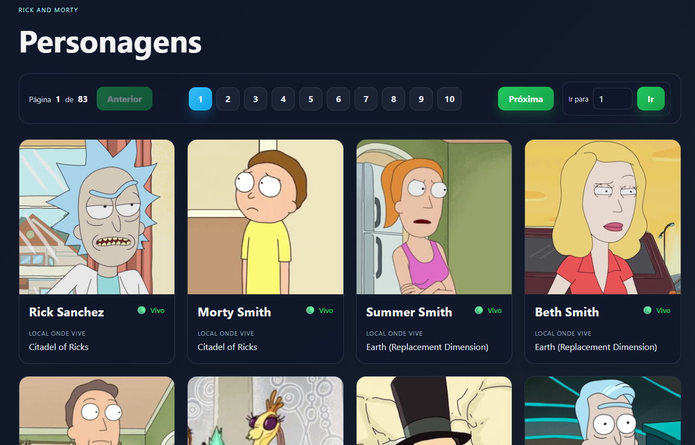

# Rick and Morty



Aplicação em Vue 3 para consumir a API pública do Rick and Morty e listar personagens com paginação.

## Funcionalidades

- Listagem de personagens da API do Rick and Morty
- Cards com nome, foto e local de residência
- Indicador visual de status com base no campo `status` da API
- Páginas navegáveis usando a paginação da API

## Requisitos

- Node.js 18+
- npm

## Como executar

1. Acesse a pasta do projeto:

```bash
cd AliBrito/Atividades/rick-and-morty
```

2. Instale as dependências:

```bash
npm install
```

3. Inicie a aplicação em modo de desenvolvimento:

```bash
npm run dev
```

4. Abra no navegador a URL exibida no terminal, normalmente:

```bash
http://localhost:5174/
```

## Build de produção

```bash
npm run build
```

## API utilizada

A aplicação consome o endpoint:

```text
https://rickandmortyapi.com/api/character
```

Os campos usados para renderização são:

- `status` para o ícone visual de vida/morte
- `location.name` para exibir o local onde o personagem vive
- `image` para a foto do personagem
